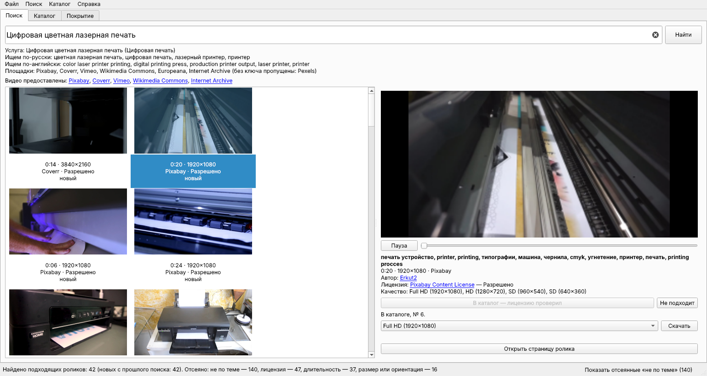
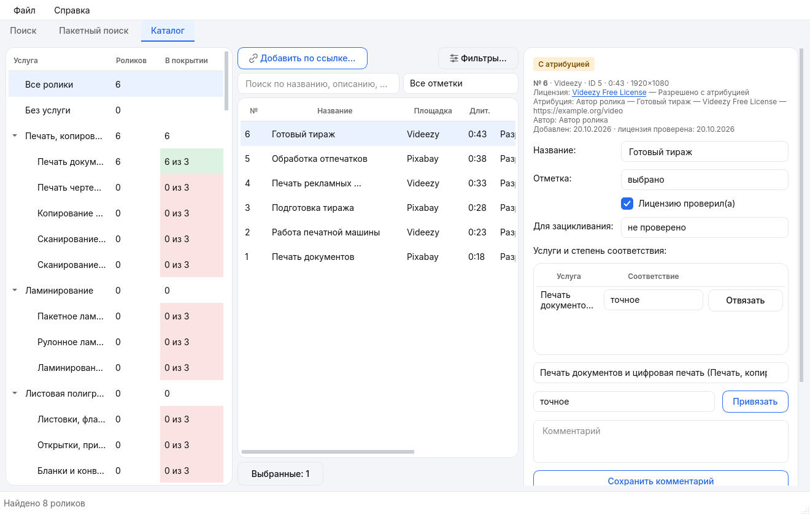

# Поиск видео для копицентров Copy.ru

Находит видеоролики о полиграфии и сувенирной продукции, даёт посмотреть и скачать их 
и ведёт каталог роликов по услугам сайта Copy.ru.

**[Скачать для Windows](https://github.com/r4v3r-63/copy-video-finder/releases/latest)** · без установки, работает с флешки

[Руководство пользователя](docs/USER_GUIDE.md) · [Изменения версий](docs/release-notes/README.md) · [Документация проекта](docs/README.md)

Демонстрационные снимки оформления 0.25.0. В текущей версии также есть «Загрузка по ссылке».

## Что умеет

Четыре раздела: **Поиск** — строка поиска по услуге или любому запросу, **Пакетный поиск** — роликов сразу по всем услугам, **Каталог** — сохранённые ролики, **Загрузка по ссылке** — отдельный подбор и скачивание из выдачи видеостока.

- **Поиск по услугам сайта.** Начните вводить услугу как на сайте Copy.ru — «визитки с фольгой», «фото на визу», «печать на толстовках» — и получите ролики по теме со стоков, видеосайтов и из интернета.
- **Просмотр и скачивание.** Ролик воспроизводится прямо в программе; можно посмотреть кадры из начала, середины и конца, скачать в нужном качестве, обрезать и убрать звук для экранов.
- **Загрузка по ссылке.** Фильтры длительности, ориентации и качества, выбор папки, пауза и прогресс; можно задать число роликов, выбрать страницу или все найденные и скачивать несколько файлов одновременно.
- **Лицензия всегда на виду.** У каждого ролика указано, можно ли его использовать свободно.
- **Каталог и покрытие.** Отобранные ролики хранятся в каталоге по услугам; видно, где роликов достаточно, а где нужен поиск.
- **Для руководства и экранов:** отчёт в PDF, реестр в Excel, HTML-каталог, плейлист и шоурил — ролики услуги одним файлом для телевизора.
- **Светлая и тёмная тема** в фирменном стиле Copy.ru, автообновление.

## Установка

1. Скачайте `CopyVideoFinder-…-windows.zip` со страницы [последней версии](https://github.com/r4v3r-63/copy-video-finder/releases/latest).
2. Распакуйте архив в любую папку (можно на флешку). Права администратора не нужны.
3. Запустите `CopyVideoFinder.exe`.

Все данные программы хранятся в папке `Данные` рядом с ней. Чтобы удалить программу, удалите её папку. Новые версии программа предлагает установить сама.

## Обновление

В программе выберите **Справка → Проверить обновления** или скачайте последний ZIP. При ручном переносе закройте программу и перенесите папку `Данные` из прежней версии рядом с новым `CopyVideoFinder.exe`.

На GitHub хранятся три последних стабильных выпуска. История изменений и теги предыдущих версий сохраняются в репозитории.
