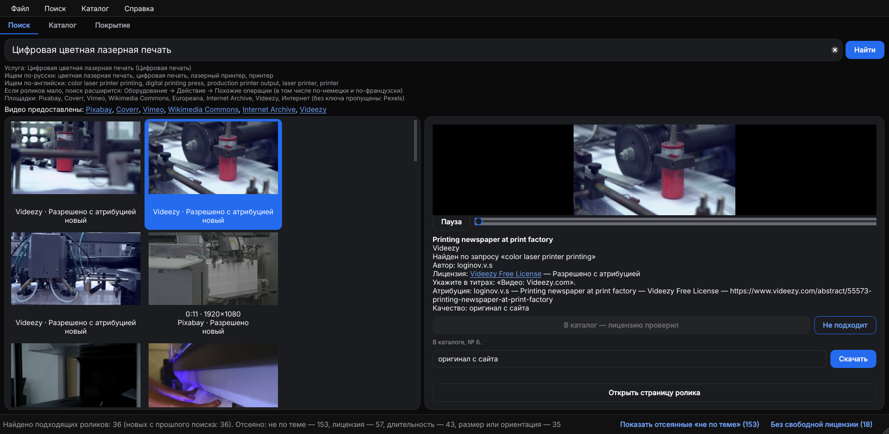

<div align="center">


# Поиск видео для копицентров Copy.ru

Ищет на бесплатных видеостоках короткие ролики о полиграфии, проверяет лицензию,<br>
даёт посмотреть и скачать подходящие и ведёт каталог роликов по 43 услугам копицентра.

[](https://github.com/r4v3r-63/copy-video-finder/releases/latest)
[](https://github.com/r4v3r-63/copy-video-finder/actions/workflows/build.yml)


**[Скачать для Windows](https://github.com/r4v3r-63/copy-video-finder/releases/latest)** · без установки, работает с флешки


</div>

## Что умеет

- **Поиск по услуге.** Начните вводить название услуги — «ламинация», «брошюровка на пружину», «лазерная гравировка» — и выберите её из подсказок. Программа сама подставит русские и английские поисковые фразы и поищет на всех площадках сразу.
- **Только полиграфия.** Ролики про стройку, еду, природу и всё, где нет слов услуги, отсеиваются. Отсеянное можно посмотреть одной кнопкой.
- **Только подходящие лицензии.** Ролики с запретом коммерческого использования или изменений (NC, ND), редакционные, премиум и платные не показываются никогда.
- **Просмотр и скачивание.** Ролик воспроизводится прямо в программе. Скачивается в выбранном качестве, рядом кладётся файл с лицензией, автором и готовым текстом атрибуции. WebM автоматически конвертируется в MP4.
- **Каталог и покрытие.** Отобранные ролики привязываются к услугам; видно, по каким услугам ролики уже есть, а где нужен поиск.
- **Экспорт.** Реестр в Excel и CSV, HTML-каталог для просмотра в браузере, сводка покрытия, плейлист M3U для телевизора.
- **Автообновление.** Новая версия с GitHub ставится одной кнопкой, настройки и ролики сохраняются.
- **Светлая и тёмная тема** в фирменном стиле Copy.ru — по настройке Windows или на выбор.

## Установка

1. Скачайте `CopyVideoFinder-…-windows.zip` со страницы [последней версии](https://github.com/r4v3r-63/copy-video-finder/releases/latest).
2. Распакуйте архив в любую папку (можно на флешку). Права администратора не нужны.
3. Запустите `CopyVideoFinder.exe`.

Ключи площадок уже встроены — программа ищет сразу после запуска.

Программа ничего не пишет в реестр и системные папки. Настройки, ключи API, кэш, журнал, каталог и скачанные ролики хранятся в папке `Данные` рядом с `CopyVideoFinder.exe`. Чтобы удалить программу, удалите её папку.

## Как пользоваться

1. Введите название услуги и выберите её из подсказок. Можно ввести и свой запрос — на русском или на английском.
2. В выдаче — горизонтальные ролики до 3 минут, не ниже HD, с лицензией «Разрешено» или «Разрешено с атрибуцией». Пометка «новый» — ролик найден впервые.
3. Нажмите на ролик — он воспроизведётся справа, там же автор и лицензия.
4. Подходит — **В каталог — лицензию проверил**; не подходит — **Не подходит** (больше не появится в поиске).
5. Выберите качество (по умолчанию — лучшее до Full HD) и нажмите **Скачать**. Ролик сохранится в `Данные/Видео/Категория/Услуга/`, номер в каталоге — в начале имени файла.

Для лицензий «с атрибуцией» на экране нужно показывать титр с автором — текст есть в файле лицензии. Окончательное подтверждение лицензии — за пользователем.

## Каталог


Слева — услуги с числом роликов и покрытием («2 из 3» — сколько засчитанных роликов из нужных), в середине — список с поиском и фильтром, справа — карточка ролика. В карточке можно поправить название и отметку, подтвердить лицензию, привязать ролик к другим услугам со степенью соответствия (точное, частичное, смежный процесс, только готовая продукция), отметить, подходит ли ролик для зацикливания, и оставить комментарий.

В покрытие засчитываются ролики с подтверждённой подходящей лицензией, не отклонённые, со степенью не «только готовая продукция» и не удалённые с площадки (или уже скачанные).

## Покрытие


Сколько услуг уже обеспечено роликами, сколько роликов засчитано, сколько дала каждая площадка. Красный — роликов нет, оранжевый — 1, жёлтый — 2, зелёный — цель выполнена (по умолчанию 3 ролика).

Кнопка **Искать по незаполненным услугам** ищет по всем услугам с недостатком роликов — сначала по тем, где роликов нет совсем. Ничего не скачивается; двойной щелчок по услуге открывает найденное на вкладке «Поиск».

## Оформление



Интерфейс оформлен по дизайн-системе Copy.ru: белые и почти чёрные поверхности, синий — для главных действий и активных элементов, фиолетовый — для редких акцентов, шрифт Inter. Тема — **Файл → Настройки → Оформление**: «Как в системе», «Светлая» или «Тёмная». Контраст текста в обеих темах — не ниже WCAG AA.

## Меню

**Поиск**
- **История поиска** — повторить прошлый запрос.
- **Словарь перевода** — добавить или исправить переводы русских слов на английский для запросов вне справочника услуг.

**Каталог**
- **Экспорт реестра в Excel / CSV** — все ролики каталога со всеми полями карточки; в Excel второй лист — сводка покрытия.
- **HTML-каталог** — один файл, открывается в любом браузере без интернета: поиск, фильтры, ссылки, выгрузка выбранного в CSV.
- **Сводка покрытия** — где роликов достаточно, где нужен поиск, что добавлено с прошлой сводки.
- **Плейлист M3U из скачанных** — для VLC и телевизоров; папку с роликами и плейлистом можно скопировать на флешку целиком.
- **Импорт реестра CSV** — перенести каталог на другой компьютер. Дубли не создаются.
- **Проверить ссылки сейчас** — не удалены ли ролики с площадок (автоматически — раз в неделю при запуске).
- **Найти похожие дубли** — один и тот же ролик на разных площадках, по сходству превью.

## Площадки и лицензии

| Площадка | Что даёт |
| --- | --- |
| [Pixabay](https://pixabay.com/videos/) | основная площадка, Pixabay Content License |
| [Coverr](https://coverr.co/) | Coverr License, поиск только по-английски |
| [Vimeo](https://vimeo.com/) | только ролики Creative Commons; часть скачивается на странице ролика |
| [Wikimedia Commons](https://commons.wikimedia.org/) | CC0, CC BY, CC BY-SA, общественное достояние |
| [Europeana](https://www.europeana.eu/) | архивные ролики с открытыми лицензиями |
| [Internet Archive](https://archive.org/) | CC и общественное достояние, скачивание на странице ролика |
| [Pexels](https://www.pexels.com/) | включится, когда Pexels снова начнёт выдавать ключи |

| Лицензия | Статус |
| --- | --- |
| CC0, Public Domain, Pexels License, Pixabay Content License, Coverr License | Разрешено |
| CC BY | Разрешено с атрибуцией |
| CC BY-SA | Разрешено с атрибуцией (с пометкой про share-alike) |
| С NC или ND; Editorial, Personal, Premium, платные | Отклонено — не показываются |
| Не распознана, «Royalty Free» | Требует проверки — в покрытие не засчитывается |

Программа работает только через официальные API площадок и соблюдает их лимиты; ответы кэшируются на сутки.

## Обновления

При запуске программа проверяет, вышла ли новая версия, и предлагает: «Обновить», «Позже» или «Пропустить эту версию». Обновление скачивается, проверяется по контрольной сумме SHA-256, программа перезапускается уже новой версией. Папка `Данные` не трогается. Проверить вручную — **Справка → Проверить обновления**.

## Свои ключи API

Встроенных ключей достаточно. Свой ключ можно указать в **Файл → Настройки** — он главнее встроенного.

| Площадка | Где взять |
| --- | --- |
| Pixabay | https://pixabay.com/api/docs/ (после входа в аккаунт) |
| Coverr | https://coverr.co/developers |
| Vimeo | https://developer.vimeo.com/apps — создать приложение, затем личный токен с правами public |
| Europeana | https://pro.europeana.eu/page/get-api |
| Wikimedia Commons, Internet Archive | ключ не нужен |
| Pexels | https://www.pexels.com/api/ (выдача новых ключей сейчас приостановлена) |

## Для разработчика

```
python -m venv .venv
.venv\Scripts\activate
pip install -r requirements.txt
python -m app.main
pytest
pyinstaller build.spec --noconfirm
```

Python 3.12+, PyQt6 и Qt Multimedia, requests, SQLite, openpyxl, Pillow; сборка — PyInstaller в режиме папки. Дизайн-токены (цвета, размеры, шрифты) — в `app/design.py`, оформление Qt — в `app/ui/theme.py`. FFmpeg для разработки: положите `ffmpeg.exe` и `ffprobe.exe` в папку `ffmpeg` в корне проекта или установите в PATH.

Сборка для Windows — в GitHub Actions: **Actions → Сборка для Windows → Run workflow**. Без версии — ZIP в артефактах запуска; с версией (например, `0.12.0`) — ещё и выпуск в Releases с тегом `v0.12.0`. Ключи площадок встраиваются из секретов репозитория и в коде не хранятся.

Правила проекта и устройство кода — в [CLAUDE.md](CLAUDE.md).
