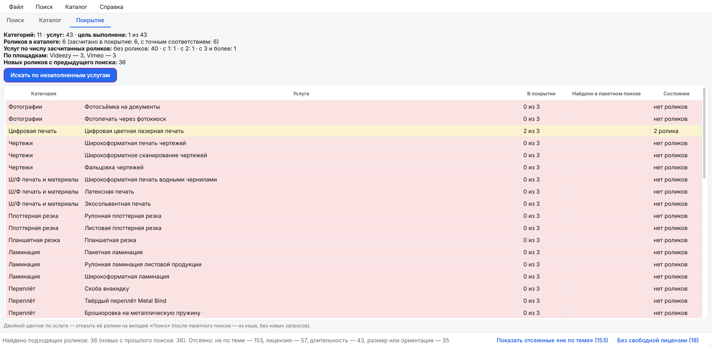
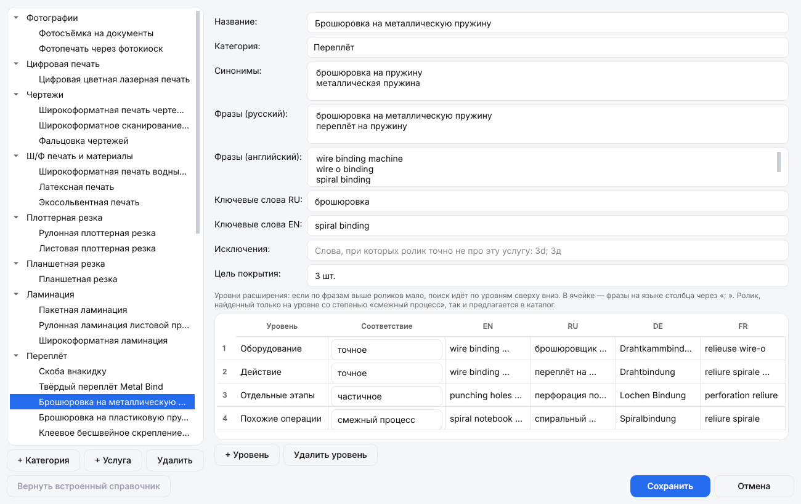

<div align="center">


# Поиск видео для копицентров Copy.ru

Ищет на бесплатных видеостоках и в интернете короткие ролики о полиграфии, проверяет лицензию,<br>
даёт посмотреть и скачать подходящие и ведёт каталог роликов по 43 услугам копицентра.

[](https://github.com/r4v3r-63/copy-video-finder/releases/latest)
[](https://github.com/r4v3r-63/copy-video-finder/actions/workflows/build.yml)


**[Скачать для Windows](https://github.com/r4v3r-63/copy-video-finder/releases/latest)** · без установки, работает с флешки


</div>

## Что умеет

- **Поиск по услуге.** Начните вводить название — «ламинация», «брошюровка на пружину», «лазерная гравировка» — и выберите услугу из подсказок. Программа сама подставит поисковые фразы и поищет на всех площадках сразу.
- **Ищет как опытный редактор.** Сначала по названию услуги, если роликов мало — по оборудованию, действию, отдельным этапам и похожим операциям; на английском, русском, немецком и французском.
- **Только полиграфия.** Ролики про стройку, еду, металлообработку, игры и всё, где нет слов услуги, отсеиваются.
- **Только честные лицензии.** В выдаче — ролики, которые можно бесплатно использовать в коммерческих целях. Ещё ролики по теме без свободной лицензии видны отдельно, только для просмотра; платные — никогда.
- **Просмотр и скачивание.** Ролик воспроизводится прямо в программе, скачивается в выбранном качестве, рядом — файл с лицензией, автором и готовым текстом атрибуции. WebM и MOV автоматически конвертируются в MP4.
- **Каталог и покрытие** по 43 услугам: что уже есть, где нужен поиск, пакетный поиск по незаполненным услугам.
- **Экспорт:** реестр в Excel и CSV, HTML-каталог, сводка покрытия, плейлист M3U для телевизора.
- **Свой справочник услуг:** категории, услуги и поисковые фразы редактируются в программе.
- **Автообновление**, **светлая и тёмная тема** в фирменном стиле Copy.ru.

## Установка

1. Скачайте `CopyVideoFinder-…-windows.zip` со страницы [последней версии](https://github.com/r4v3r-63/copy-video-finder/releases/latest).
2. Распакуйте архив в любую папку (можно на флешку). Права администратора не нужны.
3. Запустите `CopyVideoFinder.exe`.

Ключи площадок уже встроены — программа ищет сразу после запуска.

Программа ничего не пишет в реестр и системные папки. Настройки, ключи, кэш, журнал, каталог и скачанные ролики хранятся в папке `Данные` рядом с `CopyVideoFinder.exe`. Чтобы удалить программу, удалите её папку.

## Как пользоваться

1. Введите название услуги и выберите её из подсказок. Можно ввести и свой запрос — на русском или на английском.
2. В выдаче — горизонтальные ролики до 3 минут, не ниже HD, со свободной лицензией. Пометка «новый» — ролик найден впервые, «смежный процесс» — нашёлся только по похожим операциям.
3. Нажмите на ролик — он воспроизведётся справа, там же автор, лицензия и запрос, по которому он нашёлся.
4. Подходит — **В каталог — лицензию проверил**; не подходит — **Не подходит** (больше не появится в поиске).
5. Выберите качество (по умолчанию — лучшее до Full HD) и нажмите **Скачать**. Ролик сохранится в `Данные/Видео/Категория/Услуга/`, номер в каталоге — в начале имени файла.

Внизу окна две кнопки:

- **Показать отсеянные «не по теме»** — ролики со свободной лицензией, но без слов услуги в названии и тегах.
- **Без свободной лицензии** — ролики по теме с лицензией «все права защищены», с запретом коммерческого использования или изменений. Их можно только посмотреть: скачать и засчитать в покрытие нельзя, использовать — лишь с разрешения автора (кнопка «Открыть страницу ролика»).

Для лицензий «с атрибуцией» на экране нужно показывать титр с автором — текст есть в файле лицензии. Окончательное подтверждение лицензии — за пользователем.

## Как программа ищет

1. **Фразы услуги.** У каждой из 43 услуг — фразы на русском и английском и короткие ключевые слова («laminator»).
2. **Уровни расширения.** Если подходящих роликов мало, поиск идёт дальше: оборудование → действие → отдельные этапы → похожие операции, в том числе по-немецки и по-французски.
3. **Площадки и интернет.** Запросы уходят на все площадки сразу, а через поисковики (Tavily, без ключа — DuckDuckGo) — ещё и по страницам бесплатных стоков, как запрос `site:` в поисковике.
4. **Фильтр темы.** Ролик показывается, только если в названии или тегах есть все слова хотя бы одной фразы услуги и есть слово полиграфии, а слов чужих тем — нет.
5. **Фильтр лицензии, длительности и размера.** Лицензия — по таблице ниже; длительность — 5–180 секунд (меняется в настройках); только горизонтальные ролики не ниже HD.

Лимиты площадок соблюдаются, ответы кэшируются на сутки.

## Каталог


Слева — услуги с числом роликов и покрытием («2 из 3» — сколько засчитанных роликов из нужных), в середине — список с поиском и фильтром, справа — карточка ролика. В карточке можно поправить название и отметку, подтвердить лицензию, привязать ролик к другим услугам со степенью соответствия (точное, частичное, смежный процесс, только готовая продукция), отметить, подходит ли ролик для зацикливания, и оставить комментарий.

В покрытие засчитываются ролики с подтверждённой свободной лицензией, не отклонённые, со степенью не «только готовая продукция» и не удалённые с площадки (или уже скачанные).

## Покрытие



Сколько услуг уже обеспечено роликами, сколько роликов засчитано, сколько дала каждая площадка. Красный — роликов нет, оранжевый — 1, жёлтый — 2, зелёный — цель выполнена (по умолчанию 3 ролика).

Кнопка **Искать по незаполненным услугам** ищет по всем услугам с недостатком роликов — сначала по тем, где роликов нет совсем. Поминутные лимиты площадок программа пережидает сама. Ничего не скачивается; двойной щелчок по услуге открывает найденное на вкладке «Поиск».

## Справочник услуг



**Поиск → Справочник услуг**: категории и услуги, синонимы для подсказок, поисковые фразы, ключевые слова, слова-исключения, цель покрытия и уровни поиска на четырёх языках. Правки хранятся в папке `Данные`, встроенный справочник возвращается одной кнопкой. При переименовании услуги ролики каталога остаются к ней привязаны.

## Меню

**Поиск**
- **История поиска** — повторить прошлый запрос.
- **Справочник услуг** — см. выше.
- **Словарь перевода** — переводы русских слов на английский для запросов вне справочника услуг.

**Каталог**
- **Экспорт реестра в Excel / CSV** — все ролики каталога со всеми полями карточки; в Excel второй лист — сводка покрытия.
- **HTML-каталог** — один файл, открывается в любом браузере без интернета: поиск, фильтры, ссылки, выгрузка выбранного в CSV.
- **Сводка покрытия** — где роликов достаточно, где нужен поиск, что добавлено с прошлой сводки.
- **Плейлист M3U из скачанных** — для VLC и телевизоров; папку с роликами и плейлистом можно скопировать на флешку целиком.
- **Импорт реестра CSV** — перенести каталог на другой компьютер. Дубли не создаются.
- **Проверить ссылки сейчас** — не удалены ли ролики с площадок (автоматически — раз в неделю при запуске).
- **Найти похожие дубли** — один и тот же ролик на разных площадках, по сходству превью.

**Файл → Настройки** — длительность роликов, папка для скачивания, 4K, оформление, свои ключи площадок.

## Площадки и лицензии

| Площадка | Что даёт |
| --- | --- |
| [Pixabay](https://pixabay.com/videos/) | основная площадка, Pixabay Content License |
| [Coverr](https://coverr.co/) | Coverr License, поиск только по-английски |
| [Vimeo](https://vimeo.com/) | ролики Creative Commons; часть скачивается на странице ролика |
| [Wikimedia Commons](https://commons.wikimedia.org/) | CC0, CC BY, CC BY-SA, общественное достояние |
| [Europeana](https://www.europeana.eu/) | архивные ролики с открытыми лицензиями |
| [Internet Archive](https://archive.org/) | CC и общественное достояние, скачивание на странице ролика |
| [Videezy](https://www.videezy.com/) | бесплатные ролики Videezy Free License — с указанием Videezy.com в титрах |
| Интернет | поиск через Tavily или DuckDuckGo: страницы бесплатных стоков и любые сайты, где на странице есть файл ролика и открытая лицензия Creative Commons |
| [Pexels](https://www.pexels.com/) | включится, когда Pexels снова начнёт выдавать ключи |

YouTube и Mixkit не подключаются; платные стоки и соцсети в выдаче поисковиков пропускаются.

| Лицензия | Статус |
| --- | --- |
| CC0, Public Domain, Pexels License, Pixabay Content License, Coverr License | Разрешено |
| CC BY, Videezy Free License | Разрешено с атрибуцией |
| CC BY-SA | Разрешено с атрибуцией (с пометкой про share-alike) |
| С NC или ND, «все права защищены», не распознана | Только посмотреть — по кнопке «Без свободной лицензии» |
| Editorial, Personal, Premium, Pro, платные | Не показываются |

## Обновления

При запуске программа проверяет, вышла ли новая версия, и предлагает: «Обновить», «Позже» или «Пропустить эту версию». Обновление скачивается, проверяется по контрольной сумме SHA-256, программа перезапускается уже новой версией. Папка `Данные` не трогается. Проверить вручную — **Справка → Проверить обновления**.

## Свои ключи API

Встроенных ключей достаточно. Свой ключ можно указать в **Файл → Настройки** — он главнее встроенного.

| Площадка | Где взять |
| --- | --- |
| Pixabay | https://pixabay.com/api/docs/ (после входа в аккаунт) |
| Coverr | https://coverr.co/developers |
| Vimeo | https://developer.vimeo.com/apps — создать приложение, затем личный токен с правами public |
| Europeana | https://pro.europeana.eu/page/get-api |
| Tavily (поиск по интернету) | https://app.tavily.com — бесплатно, без карты, 1000 запросов в месяц; программа тратит не больше 900 |
| Brave Search (необязательно) | https://brave.com/search/api/ — платный, но $5 в месяц бесплатно; программа за бесплатный кредит не выходит |
| Wikimedia Commons, Internet Archive, Videezy, DuckDuckGo | ключ не нужен |
| Pexels | https://www.pexels.com/api/ (выдача новых ключей сейчас приостановлена) |

## Для разработчика

```
python -m venv .venv
.venv\Scripts\activate
pip install -r requirements-dev.txt
python -m app.main
pytest
pyinstaller build.spec --noconfirm
```

Python 3.12+, PyQt6 и Qt Multimedia, requests, SQLite, openpyxl, Pillow; сборка — PyInstaller в режиме папки (однофайловый exe антивирусы принимают за троян). `requirements.txt` — то, что нужно программе, `requirements-dev.txt` — ещё тесты и сборка. FFmpeg для разработки: положите `ffmpeg.exe` и `ffprobe.exe` в папку `ffmpeg` в корне проекта или установите в PATH.

```
app/           программа: окна (ui/), площадки (sources/), поиск, каталог, экспорт, обновления
resources/     справочник 43 услуг, словарь перевода, логотип, шрифт Inter
tests/         тесты на сохранённых ответах площадок (tests/fixtures), без обращений к сети
docs/          скриншоты для README и картинка для превью репозитория
```

Выпуск версии — в GitHub Actions: обновить `__version__` в `app/__init__.py`, затем **Actions → Сборка для Windows → Run workflow** с номером версии. Сборка прогоняет тесты, встраивает ключи площадок из секретов репозитория (в коде их нет), кладёт FFmpeg и публикует ZIP с контрольной суммой в Releases.

Правила проекта и устройство кода подробно — в [CLAUDE.md](CLAUDE.md).
